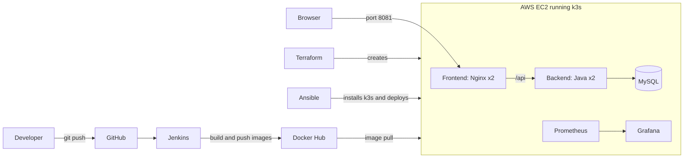
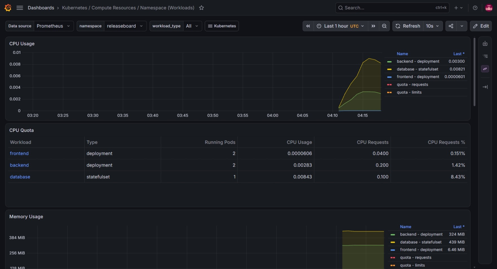
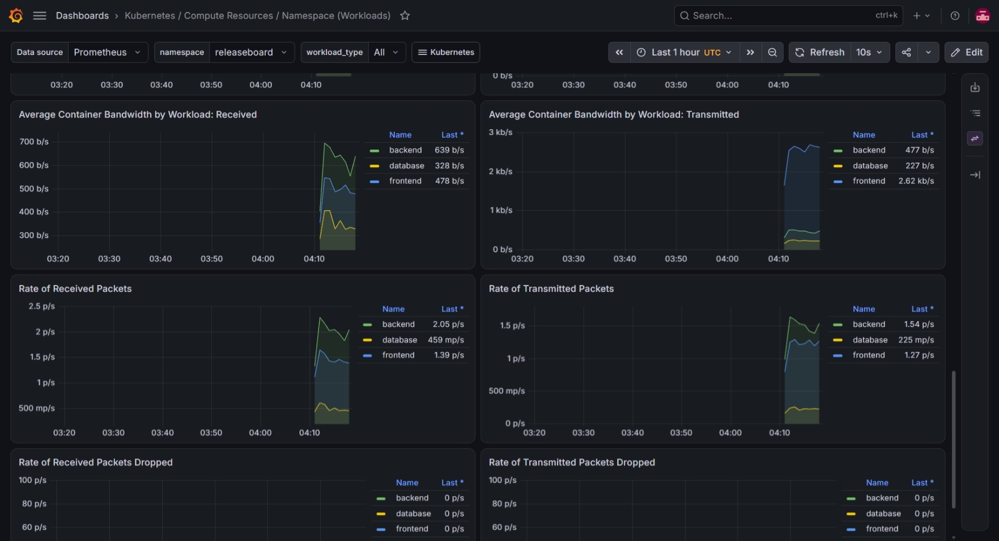

# ReleaseBoard: Three-Tier DevOps Project

A three-tier release tracking app taken from source code to a monitored Kubernetes deployment on AWS.

## Architecture



## Tools

| Area | Tool |
|---|---|
| Version control | Git, GitHub |
| Build | Maven, Docker |
| Local run | Docker Compose |
| CI | Jenkins, Docker Hub |
| Infrastructure | Terraform, AWS EC2 (ap-south-1) |
| Configuration and deployment | Ansible |
| Orchestration | Kubernetes (k3s) |
| Monitoring | Prometheus, Grafana (kube-prometheus-stack) |

## Highlights

- Jenkins pipeline builds both images and pushes them to Docker Hub, tagged with the build number
- Terraform creates the server, key pair and firewall rules
- Ports 22, 8081 and 3000 are open only to the administrator's IP address
- MySQL runs as a StatefulSet with persistent storage
- Frontend and backend run with 2 replicas each, with readiness probes
- Passwords are kept in `.env`, Kubernetes Secrets and Jenkins credentials, not in Git
- The server is destroyed after each session to control cost

## Project structure

```
backend/            Java backend and Dockerfile
frontend/           Web page, Nginx config and Dockerfile
database/init.sql   Database setup
docker-compose.yml  Local setup
Jenkinsfile         CI pipeline
infra/terraform/    AWS infrastructure
infra/ansible/      k3s, app and monitoring playbooks
k8s/app.yml         Kubernetes manifests
monitoring/         Prometheus and Grafana configuration
```

## Run locally

Create a `.env` file in the project folder:

```
DB_PASSWORD=choose-a-password
DB_ROOT_PASSWORD=choose-another-password
RELEASE_TOKEN=choose-a-token
```

```bash
docker compose up -d --build
```

Open http://localhost:8081

## Deploy to AWS

Requirements: Terraform, AWS CLI (configured), Ansible, a `.env` file and an SSH key:

```bash
ssh-keygen -t ed25519 -f ~/.ssh/releaseboard
terraform -chdir=infra/terraform init
terraform -chdir=infra/terraform apply

IP=$(terraform -chdir=infra/terraform output -raw public_ip)
cat > infra/ansible/inventory.ini <<INV
[server]
$IP ansible_user=ubuntu ansible_ssh_private_key_file=~/.ssh/releaseboard ansible_ssh_common_args='-o StrictHostKeyChecking=accept-new'
INV

ansible-playbook -i infra/ansible/inventory.ini infra/ansible/k3s.yml
ansible-playbook -i infra/ansible/inventory.ini infra/ansible/deploy.yml
ansible-playbook -i infra/ansible/inventory.ini infra/ansible/monitoring.yml
```

App: `http://<server-ip>:8081`  
Grafana: `http://<server-ip>:3000`

When finished:

```bash
terraform -chdir=infra/terraform destroy
```

To use your own images, change the Docker Hub username in `Jenkinsfile` and `k8s/app.yml`.

## Challenges solved

- **Jenkins could not find the code:** the job pointed to `master`, so it was changed to `main`.
- **Pipeline needed Linux and Docker:** moved from a Windows Jenkins to Jenkins on Ubuntu (WSL).

## Future improvements

- Deploy new image tags automatically from Jenkins
- Add automated tests to the pipeline
- Add HTTPS and a domain name
- Add application metrics and alerts

## Screenshots

### Grafana: CPU and memory



### Grafana: network


